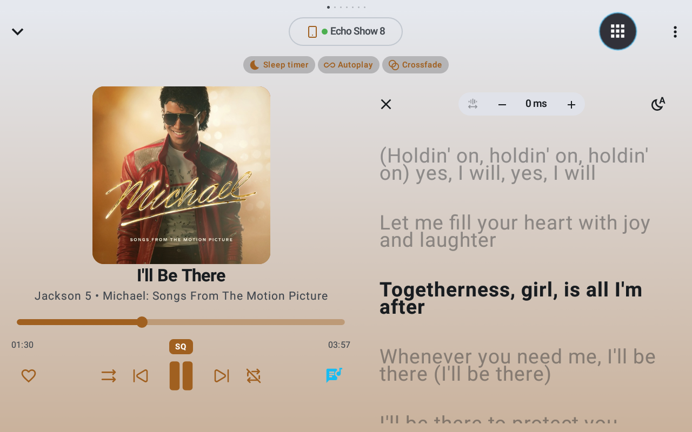

# Music Assistant Mobile — Echo Show & Smart Display Edition

> **Fork Notice:** This repository is an enhanced fork of the official [Music Assistant Mobile App](https://github.com/music-assistant/mobile-app) (`music-assistant/mobile-app`), specifically modified for **Amazon Echo Show devices** (tested on Echo Show 8 1st Gen, compatible with any rooted / sideloadable Echo Show or older Android device), featuring a **side-by-side synchronized lyrics mode**, **AudioTrack playback fixes**, and **minSdk 25** compatibility.
> 
> * **Upstream Repository:** [music-assistant/mobile-app](https://github.com/music-assistant/mobile-app)
> * **Music Assistant Server:** [music-assistant/server](https://github.com/music-assistant/server)

<p align="center">
  
  <br>
  <em>Music Assistant running on Amazon Echo Show 8 (FireOS 6 / Android 7.1.2) with side-by-side synchronized lyrics and tap-to-seek</em>
</p>

---

## 🌟 Fork Key Modifications & Features

### 1. Amazon Echo Show & Older Android Support (API 25+ / FireOS)
- **Tested on Echo Show 8 (1st Gen):** Fully tested, verified, and running smoothly on an Amazon Echo Show 8 1st Gen (`crown`, FireOS 6 / Android 7.1.2 Nougat).
- **Works on Any Sideloadable Echo Show:** Compatible with any Amazon Echo Show device where APK sideloading is available (rooted, bootloader unlocked, or running custom FireOS builds, e.g. Echo Show 5, Echo Show 8 1st/2nd Gen, Echo Show 10, Echo Show 15) as well as older Android tablets.
- **Lowered `minSdk` to 25:** Enables installation and reliable execution on Android 7.1.2 Nougat / FireOS 6+ devices without crashing on unsupported higher APIs.
- **`AudioTrackSink` Playback Fixes:** Resolved audio output crashes and buffer underruns on older Android audio HALs by properly configuring stereo channel masks (`AudioFormat.CHANNEL_OUT_STEREO`), buffer size calculations, and PCM sample routing.
- **X25519 Noise Protocol Cryptography Fallback:** Standard Android Nougat lacks native JCA support for `KeyFactory.getInstance("X25519")` (introduced in API 33). Added a pure Kotlin / BouncyCastle X25519 cryptographic fallback to ensure encrypted Sendspin local audio streaming works out-of-the-box.
- **Smart Display Form-Factor Optimization:** Tuned window sizing, touch targets, and layout responsiveness for smart display landscape dimensions (e.g. 1280x800).

### 2. Synchronized Lyrics Mode & Smart Display Layout
- **Side-by-Side Tablet / Smart Display Layout:** On wide landscape displays (`WindowClass.isWide()`), the bottom modal sheet is suppressed in favor of a 2-column layout matching the Music Assistant Web player.
- **Real-Time Synchronized Lyrics:** Automatically tracks playback position, auto-scrolls smoothly, and centers the current active line in bold typography while dimming surrounding lines.
- **Tap-to-Seek:** Tap any synchronized lyric line to immediately seek playback (`PlayerAction.SeekTo`) to that exact moment and re-center the viewport.
- **Multi-Source Lyrics & LRCLIB Fallback:** Seamlessly resolves lyrics in priority order:
  1. Embedded track metadata (instant fast path).
  2. Music Assistant server API (`metadata/get_track_lyrics`).
  3. Open [LRCLIB](https://lrclib.net) database fallback with automatic query cleaning (stripping radio markers, parentheticals, and `Artist - Title` radio formats).
  4. Fully supports both library tracks and live radio / stream metadata (`player.currentMedia`).
- **Intuitive Controls:** Tap the album artwork, the player controls lyrics icon, or the panel close button (`✕`) to seamlessly toggle between the Queue and the Lyrics view.

---

## 🚀 Building & Installing

### Prerequisites
- JDK 17 or later
- Android SDK with platform API 36 / build-tools installed
- Target device connected via USB or ADB over Wi-Fi (e.g. `adb connect <DEVICE_IP>:5555`)

### 1. Build the Android APK
```bash
# Clone this repository
git clone git@github.com:solvedro/music-assistant-mobile.git
cd music-assistant-mobile

# Assemble Debug APK
./gradlew :androidApp:assembleDebug
```
The compiled APK will be at:
`androidApp/build/outputs/apk/debug/androidApp-debug.apk`

### 2. Install on Amazon Echo Show (or any Android device)
```bash
# Connect to your Echo Show via ADB (if using network debugging)
adb connect <DEVICE_IP>:5555

# Sideload the APK
adb -s <DEVICE_IP>:5555 install -r androidApp/build/outputs/apk/debug/androidApp-debug.apk

# Launch Music Assistant
adb -s <DEVICE_IP>:5555 shell monkey -p io.music_assistant.client -c android.intent.category.LAUNCHER 1
```

---

## 📱 Upstream Core Features

This fork retains the full feature set of the cross-platform Music Assistant mobile client:
- **Queue & Playback Management:** Control players, queues, volume, playback speed, and DSP settings across all Music Assistant players.
- **Grouping:** Manage dynamic and static player groups.
- **Sendspin Local Streaming:** Stream high-resolution audio directly to your device over WebRTC or WebSocket.
- **Comprehensive Settings:** Server connection, authentication (built-in and OAuth), player delays, and local player configuration.
- **Android Auto Support:** Media service, notification controls, and Google Assistant voice actions.

---

## 🔗 Server Compatibility & Upstream Project

- **Server Compatibility:** Requires a running instance of [Music Assistant Server](https://github.com/music-assistant/server) (v2.x).
- **Official Mobile App:** For the upstream development project, see [music-assistant/mobile-app](https://github.com/music-assistant/mobile-app).

---

[](https://www.openhomefoundation.org/)
